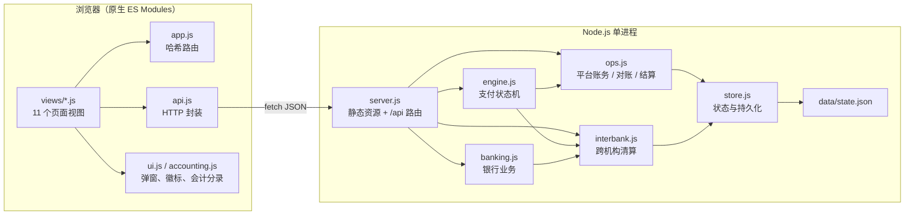
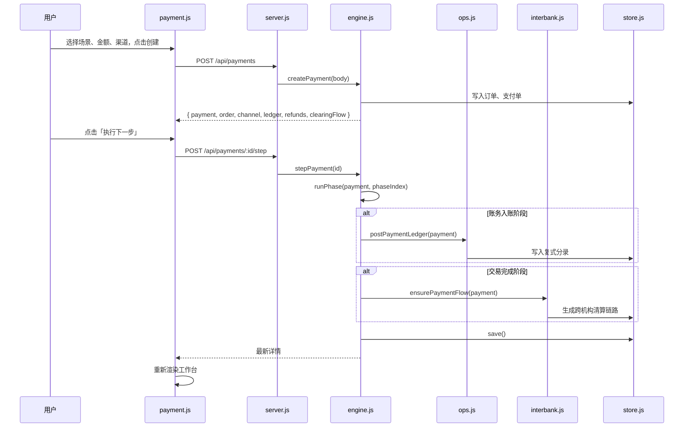
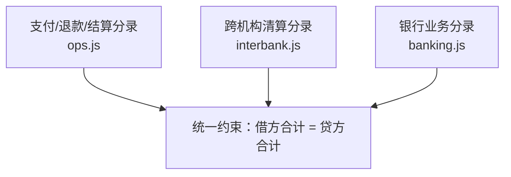
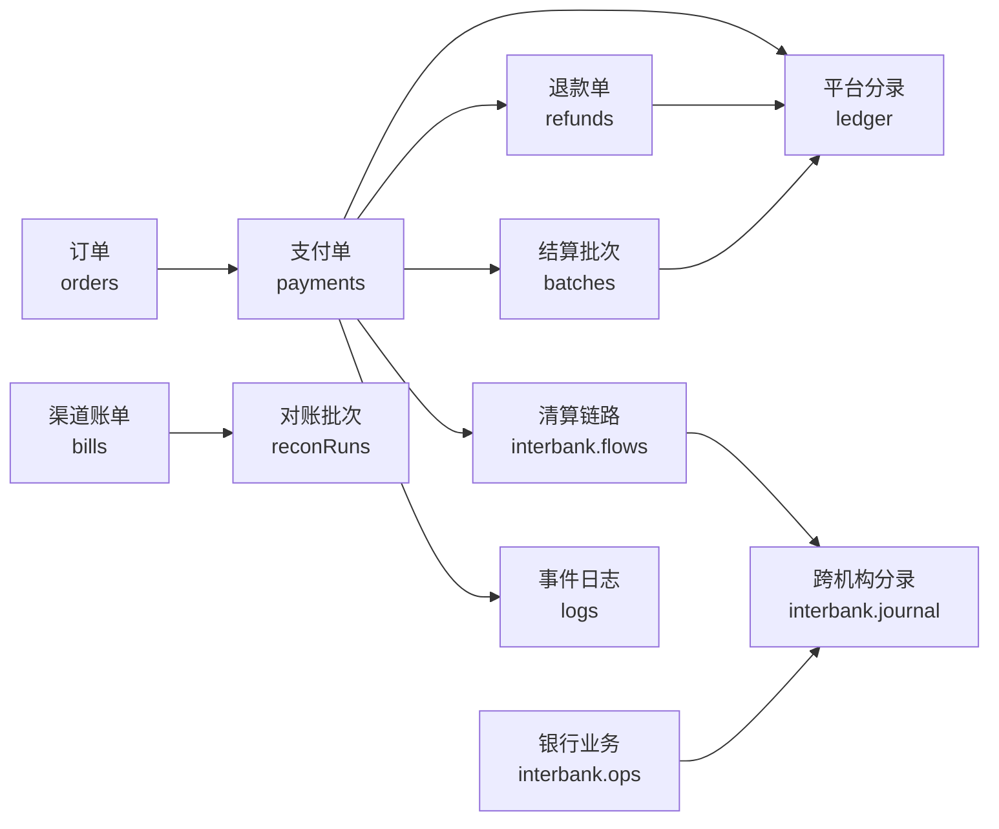

# 系统架构

PayLab 采用「单进程 Node.js 服务 + 原生 ES Modules 前端 + JSON 文件持久化」的最小架构。没有数据库、没有构建工具、没有第三方依赖，便于把注意力放在支付业务本身。

## 1. 分层结构



| 层 | 目录 | 职责 |
| --- | --- | --- |
| 页面层 | `public/js/views/` | 每个导航对应一个视图模块，负责渲染与交互 |
| 前端基础设施 | `public/js/` | 路由、API、状态、弹窗、金额/时间格式化、复式分录组件 |
| HTTP 服务 | [server/server.js](../server/server.js) | 静态文件、JSON 请求解析、API 分发、统一响应封装 |
| 支付领域 | [server/engine.js](../server/engine.js) | 12 阶段状态机、场景、风控、退款、阶段详情 |
| 平台账务 | [server/ops.js](../server/ops.js) | 支付/退款/结算分录、对账、结算批次 |
| 跨机构清算 | [server/interbank.js](../server/interbank.js) | 9 家机构、7 类清算场景、逐环节记账、试算平衡 |
| 银行会计 | [server/banking.js](../server/banking.js) | 存款、贷款、中间业务与客户存款视图 |
| 状态存储 | [server/store.js](../server/store.js) | 内存状态、120ms 防抖持久化、首次启动建房与播种 |

## 2. 一次请求的完整路径

以「创建交易并执行下一步」为例：



所有 API 返回统一包络：

```json
{ "ok": true, "data": {} }
```

失败时：

```json
{ "ok": false, "error": "错误说明" }
```

前端 [public/js/api.js](../public/js/api.js) 会在 `ok: false` 时抛出异常，页面统一用 toast 展示。

## 3. 前端路由

[public/js/app.js](../public/js/app.js) 使用哈希路由，无需服务端重写规则：

| 路由 | 视图 | 说明 |
| --- | --- | --- |
| `#/overview` | `overview.js` | 总览与支付全景 |
| `#/payment` | `payment.js` | 全链路演练台 |
| `#/stage/:paymentId/:index` | `stage.js` | 阶段详情 |
| `#/reliability` | `reliability.js` | 可靠性实验室 |
| `#/refund` | `refund.js` | 退款与冲正 |
| `#/reconcile` | `reconcile.js` | 对账中心 |
| `#/settlement` | `settlement.js` | 清结算 |
| `#/clearing` | `clearing.js` | 清算网络 |
| `#/banking` | `banking.js` | 银行会计 |
| `#/risk` | `risk.js` | 风控引擎 |
| `#/logs` | `logs.js` | 报文与日志 |

每个视图模块导出 `render(root, params)`；路由切换时先执行上一个视图返回的清理函数（例如停止自动播放定时器），再挂载新视图。

## 4. 核心设计决策

### 4.1 金额统一用「分」

服务端所有金额字段都是整数分：

- `toCents(128.00)` → `12800`
- `fmtCents(12800)` → `"128.00"`
- 手续费使用 `Math.round`，最低 1 分
- 汇率折算同样在分级别四舍五入

这避免了 `0.1 + 0.2 !== 0.3` 一类浮点问题，也让借贷平衡可以直接用整数比较。

### 4.2 事件即教学素材

支付单内的 `events[]` 保存每个阶段的：

- `request` / `response` 报文
- `signInfo`：待签串、HMAC-SHA256 签名、验签结果
- `latencyMs`：模拟耗时
- `actor` / `target`：参与方
- `level`：info / success / warn / error
- `kind`：normal / callback / query

同一事件也会写入全局日志 `state.logs`，供「报文与日志」页面检索。阶段详情页直接消费这些事件，因此「演练过程」与「教学材料」是同一份数据。

### 4.3 状态机而不是流程脚本

支付单只保存 `status`、`phaseIndex`、`waiting` 等状态，推进逻辑按阶段分派。这样：

- 可以单步执行，也可以自动播放；
- 可以在任意阶段暂停等待人工动作（确认支付、人工复核、查单补偿）；
- 页面刷新后仍能从 `data/state.json` 恢复现场。

### 4.4 三层账务共用借贷规则



平台账使用 4 个科目（渠道应收款、商户待结算款、手续费收入、银行存款）；跨机构与银行账使用机构科目表（资产/负债/收入）。清算链路与银行业务最终都写入 `state.interbank.journal`，每条分录在写入时校验平衡。

### 4.5 零依赖与可移植

- 服务端只使用 `http`、`fs`、`path`、`crypto`；
- 前端使用原生 ES Modules、CSS 与 SVG，无框架、无打包；
- Windows 启动脚本在缺少 Node.js 时下载官方便携版到 `.runtime/`，不修改系统 PATH；
- 整个项目可打包为目录直接运行，适合离线课堂。

## 5. 主要数据流



所有数据都存放在同一个 `data/state.json` 中，通过单一进程串行访问，因此不需要数据库事务；写入使用「先改内存、再整体落盘」的方式，并用 120ms 防抖减少磁盘写。

## 6. 扩展点

| 需求 | 修改位置 |
| --- | --- |
| 新增支付渠道 | `engine.js` 的 `CHANNELS`，并在场景或表单中引用 |
| 新增教学场景 | `engine.js` 的 `SCENARIOS`，必要时在 `runPhase` 中加分支 |
| 新增支付阶段 | `engine.js` 的 `PHASES`、`LATENCY`、`runPhase`、`stageRows`、`stageAccounting` |
| 新增清算链路 | `interbank.js` 的 `SCENARIOS` 与 `build*Flow`，在 `buildFlow` 注册 |
| 新增银行科目/业务 | `interbank.js` 的机构 `chart`、`banking.js` 的 `OPERATION_TYPES` 与 `buildLines` |
| 新增页面 | `public/js/views/` + `app.js` 的 `routes` / `meta` |

详见 [开发与排错](11-development.md)。
