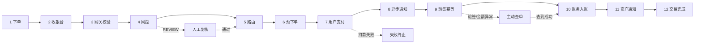
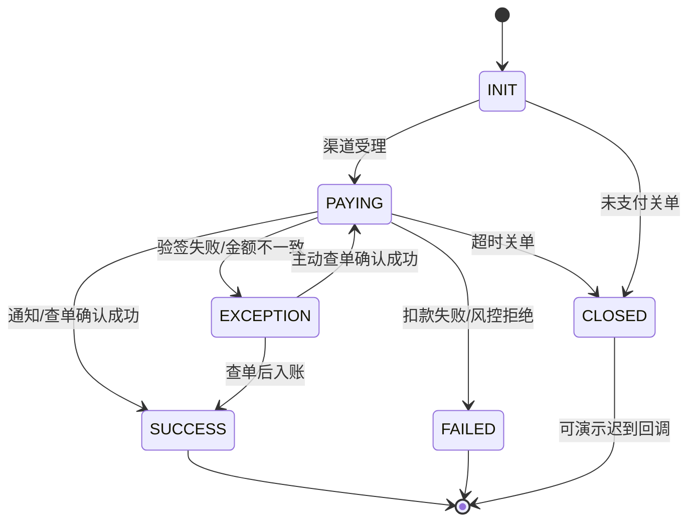
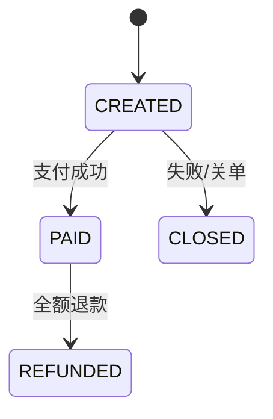

# 12 阶段支付全链路

「全链路演练台」把一笔支付拆成 12 个阶段。每个阶段既是一次状态推进，也是一份可观察的报文与账务材料。

## 1. 阶段总览

| # | 阶段 | 参与方 | 作用 | 是否记账 |
| --- | --- | --- | --- | --- |
| 1 | 用户下单 | 商户系统 → 收银台 | 创建业务订单，锁定商品与价格 | 否 |
| 2 | 收银台渲染 | 收银台 → 支付网关 | 展示渠道、采集支付要素 | 否 |
| 3 | 网关收单校验 | 支付网关 → 风控引擎 | 参数校验、商户验签、生成幂等键 | 否 |
| 4 | 实时风控决策 | 风控引擎 → 路由中心 | 规则评估，输出通过/复核/拦截 | 否 |
| 5 | 渠道路由 | 路由中心 → 支付渠道 | 在费率、成功率、限额之间选择通道 | 否 |
| 6 | 渠道预下单 | 支付渠道 → 用户 | 渠道受理，返回交易号与付款凭证 | 否 |
| 7 | 用户支付 | 用户 → 支付渠道 | 用户确认付款，渠道扣划资金 | 否 |
| 8 | 渠道异步通知 | 支付渠道 → 支付网关 | 回调交易结果，携带签名 | 否 |
| 9 | 验签与幂等 | 支付网关 → 账务中心 | 验签、金额核对、去重、状态迁移 | 否 |
| 10 | 账务入账 | 账务中心 → 商户系统 | 复式记账、拆分手续费 | 是（平台分录） |
| 11 | 商户结果通知 | 商户系统 → 支付平台 | 通知商户，失败退避重试 | 否 |
| 12 | 交易完成 | 支付平台 → 对账中心 | 生成跨机构清算链路，进入对账/结算 | 是（清算链路） |



## 2. 状态机

### 2.1 支付单



支付终态一旦落定不可回退。重复通知只触发幂等逻辑，不会再次推进状态或重复入账。

### 2.2 业务订单



订单与支付单分离：订单只表达「卖什么」，支付单表达「怎么收钱」。一笔订单可以对应多次支付尝试。

### 2.3 暂停点与可执行动作

阶段推进到需要人工参与时会写入 `payment.waiting`，前端展示对应按钮：

| `waiting.type` | 出现场景 | 可执行动作 | 结果 |
| --- | --- | --- | --- |
| `user_pay` | 预下单后 | `confirm_pay` | 用户完成付款，进入通知阶段 |
| `risk_review` | 风控决策为 REVIEW | `approve` / `reject` | 放行继续 / 终止并失败 |
| `notify_lost` | 回调丢失场景 | `query_channel` / `resend_notify` | 查单补单 / 渠道重发通知 |
| `exception` | 验签失败或金额不一致 | `query_channel` | 以渠道查单结果为准继续 |

## 3. 各阶段在教学中看什么

### 阶段 1–3：信息流与合法性

- 订单号、商户订单号、幂等键如何生成；
- 收银台只采集支付要素，不触碰资金；
- 网关先验签与幂等，而不是直接调用渠道；
- 报文中的商户 `AppID`、签名算法、待签串。

### 阶段 4：风控

- 规则表：金额阈值、夜间大额、黑名单、高频、新设备；
- 输出 `PASS` / `REVIEW` / `BLOCK` 与 0–100 风险分；
- 命中规则列表；
- 跨境交易额外输出「跨境标识」与「国际收支申报」提示。

### 阶段 5–7：路由与支付

- 主通道、备用通道与费率；
- 预下单成功不等于支付成功；
- 用户确认后渠道扣款；
- 渠道故障时自动降级到备用通道（`channel_fail` 场景）。

### 阶段 8–9：通知与幂等

- 通知报文包含金额、状态、渠道交易号、签名；
- 验签使用 HMAC-SHA256，待签串按字段名排序拼接；
- 金额核对、幂等键去重、状态迁移；
- 验签失败或金额不一致时，平台不信任报文，转主动查单。

### 阶段 10：账务入账

平台分录固定为：

```text
借：渠道应收款          ¥交易金额
  贷：商户待结算款      ¥(交易金额 − 手续费)
  贷：手续费收入        ¥手续费
```

跨境交易以人民币入账，原币金额只用于结汇折算。

### 阶段 11–12：商户通知与终态

- 商户通知同样需要签名、重试与幂等；
- `notify_retry` 场景演示首次通知超时后的退避重试；
- 交易完成后自动生成跨机构清算链路（网联/银联/CIPS 等），进入对账与结算周期。

## 4. 渠道与费率

| 渠道 | 场景 | 费率 | 结算 | 备用通道 |
| --- | --- | --- | --- | --- |
| 支付宝 | 扫码支付 | 0.60% | T+1 | 微信支付 |
| 微信支付 | 扫码支付 | 0.60% | T+1 | 支付宝 |
| 银联云闪付 | 扫码/被扫 | 0.55% | T+1 | 支付宝 |
| 账户余额 | 余额扣款 | 0 | T+0 | 支付宝 |
| 境外卡组织 | 境外卡收单 | 2.80% | T+2 | 银联云闪付 |

手续费计算：

```text
手续费 = max(1 分, round(交易金额 × 费率))
商户净额 = 交易金额 − 手续费
```

## 5. 教学场景与预期结果

| 场景 | 关键分支 | 预期终态 |
| --- | --- | --- |
| `normal` 正常支付 | 完整 12 阶段 | SUCCESS |
| `cross_border` 跨境支付 | 结汇 + CIPS + 国际收支申报 | SUCCESS，T+2 |
| `risk_block` 风控拦截 | 黑名单规则命中 | FAILED，停止在风控阶段 |
| `large_review` 大额人工审核 | 风控 REVIEW，等待复核 | 通过则 SUCCESS；拒绝则 FAILED |
| `channel_fail` 渠道故障降级 | 主通道预下单超时 | 切换备用通道后成功 |
| `insufficient_balance` 余额不足 | 余额扣款失败 | FAILED |
| `callback_dup` 重复回调 | 对已成功交易重发通知 | 幂等拦截，无新增分录 |
| `callback_lost` 回调丢失 | 渠道已扣款、通知丢失 | 查单或重发通知后成功 |
| `amount_mismatch` 金额篡改 | 通知金额不一致 | EXCEPTION → 查单后成功 |
| `bad_signature` 验签失败 | 签名无效 | EXCEPTION → 查单后成功 |
| `notify_retry` 商户通知重试 | 首次通知超时 | 重试后成功 |

## 6. 页面操作方法

1. 进入「全链路演练」；
2. 在教学场景下拉框选择场景，金额/渠道/买家会自动带出；
3. 点击「创建交易」；
4. 点击「执行下一步」逐阶段推进，或点击「自动播放」；
5. 出现暂停提示时，按提示点击「确认支付」「通过/拒绝」「主动查单」等按钮；
6. 点击阶段列表中的任意阶段，进入「阶段详情」查看数据、报文、签名与会计计算。

## 7. 阶段详情的数据来源

阶段详情 API 为 `GET /api/payments/:id/stages/:index`，返回：

| 字段 | 含义 |
| --- | --- |
| `phase` | 阶段元数据（名称、参与方、教学目标） |
| `status` | 阶段状态：done / active / waiting / failed / skipped / pending |
| `data` | 该阶段的业务数据行（订单、渠道、金额、跨境字段等） |
| `events` | 该阶段的请求、响应、签名与耗时 |
| `accounting` | 该阶段的会计计算：`ENTRY` 分录、`FLOW` 清算链路或 `NONE` |
| `links` | 推荐跳转（清算网络、对账中心等） |

未执行的阶段也会展示按当前订单预估的数据与计算口径，并标注「尚未执行」。

## 8. 相关 API

| 方法 | 路径 | 说明 |
| --- | --- | --- |
| `POST` | `/api/payments` | 创建交易 |
| `POST` | `/api/payments/:id/step` | 执行下一阶段 |
| `POST` | `/api/payments/:id/action` | 执行暂停点动作（`confirm_pay` 等） |
| `GET` | `/api/payments/:id` | 交易详情 |
| `GET` | `/api/payments/:id/stages/:index` | 阶段详情 |
| `GET` | `/api/payments/:id/accounting` | 完整会计链路 |

完整接口见 [HTTP API 参考](09-api.md)。
