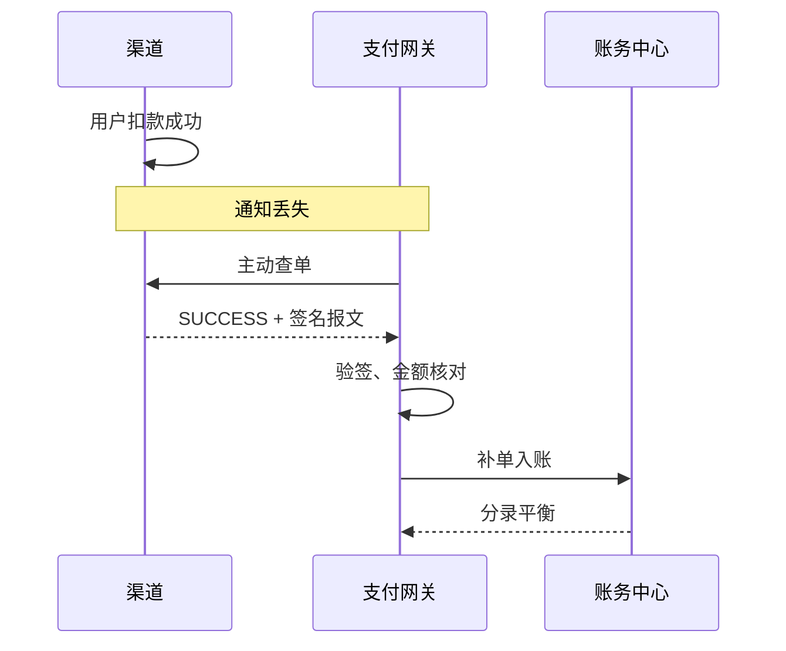
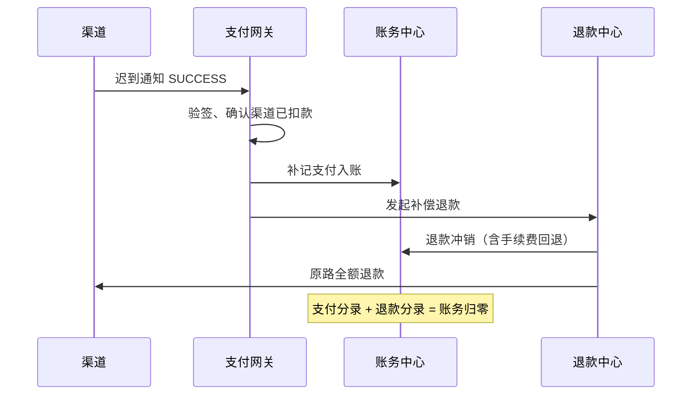

# 可靠性实验室

支付系统真正困难的部分，不是「支付成功」，而是「通知重复、丢失、乱序、延迟时仍然只记一次账」。本项目把这四类问题做成可手动复现的实验。

## 1. 四个演练动作

| 动作 | 接口 | 前置条件 | 观察重点 |
| --- | --- | --- | --- |
| 重发渠道回调 | `POST /api/payments/:id/renotify` | 交易已支付成功 | 幂等拦截，账务不新增分录 |
| 主动查单 | `POST /api/payments/:id/query` | 支付中 / 异常等待 | 以渠道权威结果为准恢复交易 |
| 超时关单 | `POST /api/payments/:id/close` | INIT / PAYING 且渠道未扣款 | 订单关闭，撤销预下单 |
| 模拟迟到回调 | `POST /api/payments/:id/late-notify` | 已关闭且未补偿 | 补记支付并自动原路退款，账务轧平 |

页面「可靠性实验室」会列出当前可执行的动作，并在执行后展示事件结果。

## 2. 幂等：重复回调只入账一次

### 两次防线

1. **支付单幂等键**：创建支付单时生成 `idempotencyKey`；重复通知只允许更新同一支付单。
2. **账务幂等**：`ops.ledgerExists(bizType, bizId)` 在写入前检查是否已有同业务分录。

```js
// server/ops.js
function ledgerExists(bizType, bizId) {
  return store.get().ledger.some((entry) =>
    entry.bizType === bizType && entry.bizId === bizId
  );
}
```

### 实验步骤

1. 完成一笔正常支付；
2. 在可靠性实验室点击「重发回调」；
3. 观察事件：
   - 渠道重复推送 `notify`；
   - 网关返回 `dedup: true`、`ledgerAction: "NONE"`；
   - 账务分录条数不变。

也可以在「全链路演练」选择 `callback_dup` 场景，在交易完成阶段自动演示一次重复通知。

### 结论

幂等不是「收到通知就入账，再去重」，而是「入账前先确认该业务是否已经处理」。支付的幂等键必须包含业务唯一标识，不能只用请求 ID。

## 3. 掉单：渠道已扣款，通知丢了

### 场景复现

选择 `callback_lost` 场景：

1. 用户确认支付后，渠道扣款成功；
2. 平台未收到通知，支付单进入 `waiting.type = "notify_lost"`；
3. 可执行：
   - `query_channel`：主动查单，查到 SUCCESS 后补单并继续入账；
   - `resend_notify`：模拟渠道补发通知。



### 为什么要主动查单

异步通知不可靠，查单接口是权威数据源。平台的最终状态必须以「通知 + 查单」共同确认，不能仅凭通知。

## 4. 验签失败与金额不一致

### 验签失败（`bad_signature`）

通知报文金额被篡改且签名无效：

1. 验签结果 `INVALID`；
2. 平台拒绝入账，支付单进入 `EXCEPTION`；
3. 等待主动查单，以渠道返回的真实结果继续。

### 金额篡改（`amount_mismatch`）

签名有效，但通知金额与订单金额不一致：

1. 验签通过；
2. 金额核对失败；
3. 同样进入 `EXCEPTION`，转主动查单。

### 教学要点

- 验签只证明「报文来自渠道且未被篡改」，不证明「金额正确」；
- 金额核对必须与本地订单逐笔比对；
- 任何异常都不能直接入账，也不能直接判失败，应转查单确认。

## 5. 超时关单

### 约束

只有同时满足以下条件才能关单：

- 状态为 `INIT` 或 `PAYING`；
- 渠道尚未扣款（`channelPaid === false`）。

如果渠道已扣款，直接关单会造成「钱已扣、单已关」的资金悬空，必须先查单。

### 关单动作

1. 写入关单事件（15 分钟超时）；
2. 支付单 `CLOSED`；
3. 订单 `CLOSED`；
4. 后续阶段标记为 `skipped`。

## 6. 迟到回调：关单后渠道才成功

这是最危险的情况之一：用户已付款，平台已关单。

### 处理流程



### 账务结果

- 补记一笔支付入账：借渠道应收款，贷商户待结算款 + 手续费收入；
- 立即发起全额补偿退款：借商户待结算款 + 手续费收入，贷渠道应收款；
- 支付与退款两笔分录合计为零，手续费同步回退；
- 支付单标记 `compensated = true`，并关联补偿退款单。

### 教学要点

- 迟到回调不能简单忽略，渠道侧资金已经真实扣划；
- 补单 + 原路退款是常见处理方式；
- 补偿退款必须回退手续费，否则账务无法轧平。

## 7. 状态与账务的一致性

| 检查项 | 期望 |
| --- | --- |
| 重复回调后分录数 | 不变 |
| 掉单补单后支付状态 | SUCCESS |
| 验签失败后 | 不入账，等待查单 |
| 关单后支付状态 | CLOSED，渠道未扣款 |
| 迟到回调后 | 已补偿，支付与退款合计为零 |
| 任意支付分录 | 借方合计 = 贷方合计 |

## 8. 通过 API 复现

```bash
# 重发回调
curl -X POST http://localhost:5178/api/payments/PAY.../renotify

# 主动查单
curl -X POST http://localhost:5178/api/payments/PAY.../query

# 超时关单
curl -X POST http://localhost:5178/api/payments/PAY.../close

# 迟到回调
curl -X POST http://localhost:5178/api/payments/PAY.../late-notify
```

完整接口与请求体见 [HTTP API 参考](09-api.md)。
