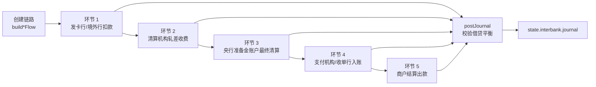

# 清算网络与银行会计

「清算网络」页面把支付之后的资金路径拆成多家机构的复式分录，逐环节执行、逐环节平衡；「银行会计」页面则单独演示商业银行自身的存贷款与中间业务。

## 1. 参与机构

项目内置 9 家机构，全部使用统一的科目表与借贷规则：

| 机构 | 类型 | 角色 | 主要科目 |
| --- | --- | --- | --- |
| `PAYLAB` 支付机构 | 支付机构 | 钱包 / 收单 / 备付金存管 | 备付金存款、钱包余额、商户待结算款、代收代付款项、清算应收/应付、服务费收入 |
| `NETSUNION` 网联清算 | 清算机构 | 第三方支付网络清算 | 清算备付金、清算应收/应付、清算服务费收入 |
| `UNIONPAY` 中国银联 | 清算机构 | 银行卡跨行转接清算 | 清算备付金、清算应收/应付、网络服务费收入 |
| `CIPS` 人民币跨境支付系统 | 清算机构 | 跨境人民币转接与清算 | 清算备付金、跨境清算应收/应付、跨境清算服务费收入 |
| `PBOC` 中国人民银行 | 中央银行 | CNAPS 大额/小额支付系统 | 对金融机构债权；各机构准备金/备付金存款（负债） |
| `ICBC` 工商银行 | 商业银行 | 发卡行 / 零售银行 | 吸收存款、库存现金、准备金、贷款、待清算、利息/手续费收入 |
| `CCB` 建设银行 | 商业银行 | 收单行 / 商户开户行 | 同上，另有境外代理行存放款项（Vostro） |
| `ABC` 农业银行 | 商业银行 | 公用事业收款行 | 同上 |
| `HSBC` 汇丰银行（境外收单行） | 商业银行 | 境外卡收单 / 结售汇 | 同上，另有存放境内代理行款项（Nostro） |

机构视图提供：

- 资产、负债、收入类科目余额；
- 客户存款明细（工商银行、建设银行、农业银行）；
- 参与机构的实时科目卡片。

## 2. 七类清算场景

| 场景 | 网络 | 环节数 | 默认金额 | 教学重点 |
| --- | --- | --- | --- | --- |
| `goods` 商品支付 | 网联 | 5 | 128.00 | 备付金模式：用户资金先进入支付机构备付金，再结算给商户 |
| `card` 银行卡消费 | 银联 | 4 | 268.00 | 发卡行、清算机构、收单行三方手续费分配 |
| `utility` 生活缴费 | 网联 | 5 | 200.00 | 代收付是中间业务，代收资金不能当作自有资金 |
| `topup` 钱包充值 | 网联 | 4 | 500.00 | 充值不是收入：资产与负债同时增加 |
| `withdraw` 钱包提现 | 网联 | 4 | 300.00 | 提现是充值与消费的逆向流程 |
| `wallet` 余额支付 | 支付机构内部 | 1 | 66.00 | 不产生跨行资金流，但仍需完成负债转移 |
| `cross_border` 跨境支付 | CIPS | 5 | 724.00 | 结汇 + 跨境清算 + 国际收支申报 |

## 3. 链路执行机制



每个环节：

- 有 `title`、`detail`、`system`、`from`、`to`、`amount`；
- 包含若干条机构级分录 `line(institution, code, debit, credit, memo)`；
- 写入前强制校验本环节借贷相等；
- 支持「单步执行」或「自动运行」。

## 4. 商品支付（网联）5 环节


| 环节 | 关键分录（简化） |
| --- | --- |
| 1 发卡行扣款 | 借 工行吸收存款；贷 工行待清算应付款 |
| 2 网联轧差 | 借 网联清算应收；贷 网联清算应付（净额）、贷 网联服务费收入 |
| 3 央行最终清算 | 工行准备金减少；网联备付金减少/应付结清；支付机构备付金增加；网联备付金增加（费用） |
| 4 支付机构入账 | 借 清算应收；贷 商户待结算款、贷 支付服务费收入 |
| 5 商户结算 | 借 商户待结算款；贷 备付金；收单行收到准备金、贷记商户存款 |

## 5. 银行卡消费（银联）4 环节

| 环节 | 关键分录 |
| --- | --- |
| 1 发卡行扣款 | 借 持卡人存款；贷 工行待清算应付款 |
| 2 银联转接 | 借 银联应收；贷 银联应付（净额）、贷 网络服务费收入 |
| 3 央行清算 | 工行准备金减少；银联备付金清算；建行准备金增加；银联费用入账 |
| 4 收单行入账 | 借 建行清算应收；贷 商户存款、贷 收单手续费收入 |

与网联模式的关键差别：银联场景中，收单行直接给商户入账并确认收单手续费，没有支付机构备付金账户这一层。

## 6. 跨境支付（CIPS）5 环节

详见 [跨境支付专题](06-cross-border.md)。简要路径：

```text
境外收单行扣款 → CIPS 转接轧差（收网络费）→ 央行准备金账户最终清算
→ 支付机构结汇入账 → 商户结算至境内开户行
```

本章重点记住两点：

- 境外收单行通过「存放境内代理行款项（Nostro）」和境内代理行的「境外代理行存放款项（Vostro）」完成跨境同业清算；
- CIPS 收取网络清算费，支付机构收取跨境收单服务费，两者在链路中分别确认收入。

## 7. 银行会计

「银行会计」页面针对工商银行、建设银行、农业银行提供 5 类业务：

| 业务 | 分录 |
| --- | --- |
| 现金存入 | 借 库存现金；贷 吸收存款 |
| 发放贷款 | 借 发放贷款；贷 吸收存款（贷款创造存款） |
| 收回贷款本息 | 借 吸收存款（本息）；贷 发放贷款（本金）、贷 利息收入 |
| 代收水电费并划转 | 借 客户存款；贷 应解汇款、贷 代理手续费收入；划转时经央行准备金账户到公用事业单位开户行 |
| 收取账户管理费 | 借 吸收存款；贷 手续费及佣金收入 |

客户存款 = 该客户所有分录的贷方累计 − 借方累计，按机构与客户分别汇总。

### 代收水电费的跨行路径

当付款行不是农业银行时：


这体现了「先代收、后划转」的中间业务特征：代收资金先计入应解汇款，不能与银行自有资金混用。

## 8. 全局试算平衡

所有机构的分录写入同一个日志 `state.interbank.journal`。页面顶部展示：

- 参与机构数量；
- 教学场景数量；
- 全局借方合计、贷方合计与 `balanced` 状态。

健康状态：

```text
Σ debit = Σ credit
```

如果某条链路设计错误，`postJournal` 会直接抛错，避免污染账务数据。

## 9. 页面操作

1. 进入「清算网络」；
2. 左侧选择场景（商品支付、银联、跨境等）；
3. 填写金额、付款人、收款人；
4. 点击「创建链路」，可单步执行或自动运行；
5. 查看每个环节的分录、参与机构、金额与平衡结果；
6. 点击机构卡片，查看实时科目余额与客户存款。

## 10. 相关 API

| 方法 | 路径 | 说明 |
| --- | --- | --- |
| `GET` | `/api/clearing` | 机构、场景、链路列表、全局试算 |
| `POST` | `/api/clearing/flows` | 创建清算链路 |
| `GET` | `/api/clearing/flows/:id` | 链路详情 |
| `POST` | `/api/clearing/flows/:id/step` | 执行下一环节 |
| `POST` | `/api/clearing/flows/:id/run` | 自动执行全部环节 |
| `GET` | `/api/banking` | 银行科目、客户存款、银行业务记录 |
| `POST` | `/api/banking/ops` | 执行一笔银行业务 |

完整接口见 [HTTP API 参考](09-api.md)。
