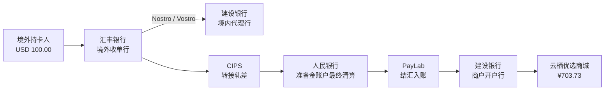

# 跨境支付专题

跨境支付比境内支付多两层：**外币结汇**与**跨境清算**。PayLab 用固定汇率与 CIPS 五环节链路把这部分完整演示出来。

## 1. 教学场景参数

| 参数 | 值 |
| --- | --- |
| 场景 | 跨境支付（境外卡） |
| 渠道 | 境外卡组织（Visa / Mastercard 多币种收单） |
| 交易金额 | ¥724.00（人民币入账） |
| 原币金额 | USD 100.00 |
| 结汇汇率 | 1 USD = 7.24 CNY |
| 通道费率 | 2.80% |
| 结算周期 | T+2 |
| 清算网络 | CIPS 人民币跨境支付系统 |
| 监管动作 | 国际收支申报（SAFE） |
| 买家标识 | `U-FOREIGN-01` |

选择该场景时，收银台、演练台、阶段详情与交易完成页都会显示 `USD 100.00 × 7.24` 的结汇徽标。

## 2. 金额计算

```text
原币金额 = round(人民币金额 ÷ 汇率)
        = round(72400 ÷ 7.24)
        = 10000 分 = USD 100.00

结汇人民币 = 原币金额 × 汇率
          = 10000 × 7.24
          = 72400 分 = ¥724.00

手续费 = round(72400 × 2.80%) = 2027 分 = ¥20.27
商户净额 = 72400 − 2027 = 70373 分 = ¥703.73
```

> 数据模型中的 `foreignAmount` 与人民币金额一样以「分」存储，展示时统一用 `fmtCents` 格式化。

## 3. 与境内支付的阶段差异

| 阶段 | 跨境附加内容 |
| --- | --- |
| 1 用户下单 | 订单报文带原币金额、汇率、结算币种 |
| 2 收银台 | 支付场景为 `CROSS_BORDER_CARD`，展示境外卡渠道 |
| 3 网关校验 | 请求体标记 `crossBorder: true`，携带结汇要素 |
| 4 风控 | 输出「跨境标识 · 境外卡收单」；额外产生一条「跨境交易标识 · 国际收支申报」事件 |
| 5 路由 | 清算网络固定为 CIPS |
| 6 预下单 | 请求/响应包含原币金额、汇率、结算币种 |
| 7 用户支付 | 响应包含 `foreignPaidAmount` |
| 8 异步通知 | 通知报文带 `foreignAmount`、`fxRate`、`settleCurrency` |
| 9 验签与幂等 | 增加结汇核对 `fxCheck: "MATCHED"` |
| 10 账务入账 | 以人民币入账，展示结汇公式；原币不单独记账 |
| 11 商户通知 | 通知商户人民币净额 |
| 12 交易完成 | 展示 CIPS、T+2 结算日、国际收支申报状态 |

## 4. 跨境五环节清算

### 4.1 资金路径



### 4.2 五个环节

| # | 环节 | 参与机构 | 金额 | 核心分录 |
| --- | --- | --- | --- | --- |
| 1 | 境外收单行扣款 | HSBC | 724.00 | 借 持卡人存款；贷 境内代理行待清算应付 |
| 2 | CIPS 转接轧差 | CIPS | 724.00 | 借 跨境清算应收；贷 跨境清算应付 723.28、贷 网络费收入 0.72 |
| 3 | 央行最终清算 | PBOC / CIPS / CCB / HSBC / PAYLAB | 724.00 | 同业存款、准备金、备付金同步借贷，结清应收应付 |
| 4 | 支付机构结汇入账 | PAYLAB | 724.00 | 借 清算应收 723.28；贷 商户待结算款 703.73、贷 跨境收单收入 19.55 |
| 5 | 商户结算出款 | PAYLAB / CCB | 703.73 | 借 商户待结算款；贷 备付金；建行收到准备金并贷记商户存款 |

### 4.3 费用拆分

```text
总手续费 ¥20.27
├─ CIPS 网络清算费 72400 × 0.1% = ¥0.72
└─ 支付机构跨境收单收入 = 20.27 − 0.72 = ¥19.55
```

链路中 CIPS 确认网络费收入，支付机构确认剩余的跨境收单服务费收入。

## 5. 第 3 环节的机构平衡

跨境链路最复杂的是央行最终清算环节，涉及 5 家机构的 13 条分录。以 ¥724.00 为例：

| 机构 | 借方 | 贷方 |
| --- | --- | --- |
| HSBC | 结清应付 724.00 | 动用境内代理行存款 724.00 |
| CCB | 境外代理行存款减少 724.00 | 向 CIPS 划付 724.00 |
| CIPS | 收到清算款 724.00；结清应付 723.28 | 结清应收 724.00；向支付机构划付 723.28 |
| PAYLAB | 备付金到账 723.28 | 清算应收 723.28 |
| PBOC | 建行准备金减少 724.00 | 支付机构备付金增加 723.28；CIPS 备付金增加 0.72 |

合计：

```text
借方 361928 分 = 贷方 361928 分
```

## 6. 国际收支申报

风控阶段会额外产生一条信息型事件：

```text
actor:  风控引擎
target: 外汇申报系统
title:  跨境交易标识 · 国际收支申报
level:  info
```

交易完成后，阶段详情与完成提示会显示：

- 交易成功：`已报送 SAFE`
- 尚未成功：`支付成功后报送`

项目中只模拟申报状态，不涉及真实申报接口与申报要素。

## 7. 操作路径

### 页面

1. 进入「全链路演练」；
2. 场景选择「跨境支付（境外卡）」，金额自动为 724.00；
3. 创建交易并逐步执行；
4. 在风控、预下单、通知、验签、账务、完成阶段观察结汇字段；
5. 进入「清算网络」，选择「跨境支付 · 境外卡」，创建并运行链路；
6. 点击 HSBC、CIPS、人民银行节点，查看实时科目余额。

### API

```bash
# 创建跨境交易
curl -X POST http://localhost:5178/api/payments \
  -H "Content-Type: application/json" \
  -d '{"scenario":"cross_border","subject":"跨境教学商品","amount":724,"channel":"crossborder","buyer":"U-FOREIGN-01"}'

# 创建跨境清算链路
curl -X POST http://localhost:5178/api/clearing/flows \
  -H "Content-Type: application/json" \
  -d '{"type":"cross_border","amount":724,"payer":"U-FOREIGN-01","payee":"云栖优选商城"}'
```

## 8. 教学边界

本项目对跨境支付做了必要简化：

- 汇率固定为 7.24，不模拟实时报价、点差与锁汇；
- 只演示人民币结算路径，不涉及多币种账户、SWIFT 报文与境外本地清算；
- 国际收支申报仅为状态标记，不包含申报单要素；
- 未包含关税、增值税、跨境物流与退汇等场景；
- 境外机构以 HSBC 为代表，国内代理行以建设银行为代表。

这些简化不影响理解核心结构：**原币折算 → 跨境转接 → 央行最终清算 → 人民币入账 → 商户结算 → 监管申报**。
