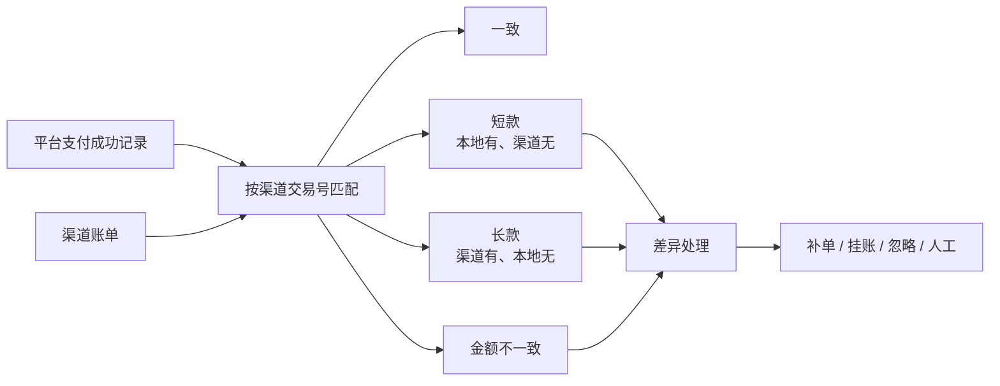

# 对账与清结算

支付成功之后，平台还要回答两个问题：

1. **渠道说我收了多少钱？** —— 对账；
2. **我该给商户多少钱？** —— 清结算。

## 1. 对账的基本模型



对账以 **渠道交易号** 为主键，逐笔比对是否存在、金额是否一致。

## 2. 生成渠道账单

`POST /api/reconcile/bills`

```json
{
  "date": "2026-11-01",
  "channel": "alipay",
  "inject": { "amount": true, "short": true, "long": true }
}
```

| 字段 | 说明 |
| --- | --- |
| `date` | 账单日期（`YYYY-MM-DD`），按支付时间归属 |
| `channel` | 渠道代码：`alipay` / `wechat` / `unionpay` / `balance` / `crossborder` |
| `inject.amount` | 把第一条金额加 ¥5.00，制造金额不一致 |
| `inject.short` | 删除最后一条，制造短款 |
| `inject.long` | 追加一条渠道独有的假交易，制造长款 |

账单内容：

```json
{
  "count": 12,
  "totalAmount": 123456,
  "totalFee": 789,
  "lines": [
    { "channelTradeNo": "CH...", "outTradeNo": "O...", "amount": 12800, "fee": 77 }
  ],
  "injected": { "amount": true, "short": true, "long": true }
}
```

如果该日期与渠道没有成功支付记录，接口返回 400。

## 3. 自动对账

`POST /api/reconcile/bills/:billId/run`

对账逻辑：

```text
本地集合 = 该日期 + 该渠道 + 支付成功
渠道集合 = 账单明细
按 channelTradeNo 做全连接
```

| 差异类型 | 含义 | 判定 |
| --- | --- | --- |
| `LOCAL_ONLY` | 短款 | 本地有，渠道账单没有 |
| `CHANNEL_ONLY` | 长款 | 渠道账单有，本地没有 |
| `AMOUNT_MISMATCH` | 金额不一致 | 两边都有，但金额不同 |

批次汇总字段：

```json
{
  "summary": {
    "localCount": 12,
    "channelCount": 12,
    "matchedCount": 10,
    "diffCount": 2,
    "localAmount": 123456,
    "channelAmount": 124006,
    "diffAmount": 550
  }
}
```

`diffAmount = 渠道金额 − 本地金额`：

- 正数：渠道多（可能长款或多收）；
- 负数：渠道少（可能短款或少收）。

## 4. 差异处理

`POST /api/reconcile/runs/:runId/diffs/:diffId/handle`

```json
{ "action": "supplement", "note": "核对渠道流水后补单" }
```

| 动作 | 含义 |
| --- | --- |
| `supplement` | 补单：以渠道记录为准补记本地 |
| `suspend` | 挂账：暂时挂起，等待进一步核查 |
| `ignore` | 忽略：确认无影响 |
| `manual` | 人工处理：线下核实 |

处理后：

- 差异状态 `PENDING → HANDLED`；
- 记录处理动作、备注、操作人与时间；
- 批次 `handledCount` 更新。

同一差异不能重复处理。

### 教学要点

- 长款不能直接当作收入；
- 短款不能直接核销，必须查明是渠道漏传还是本地丢单；
- 差异处理必须留痕；
- 对账只是发现差异，真正的资金调整要走补单、挂账或调账流程。

## 5. 清结算

### 5.1 结算批次

`POST /api/settlements/generate`

```json
{ "date": "2026-11-02" }
```

结算按 `payment.settleDate` 精确匹配：

- 支付宝、微信、银联：T+1；
- 账户余额：T+0；
- 境外卡：T+2。

同一商户、同一结算日聚合成一个批次：

```text
交易总额 = Σ 支付金额
手续费总额 = Σ 手续费
退款总额 = Σ 已成功退款
净额 = 交易总额 − 手续费总额 − 退款总额
```

批次示例：

```json
{
  "merchantId": "M2026001",
  "settleDate": "2026-11-02",
  "count": 8,
  "grossAmount": 123456,
  "feeAmount": 789,
  "refundAmount": 3000,
  "netAmount": 119667,
  "status": "PENDING"
}
```

### 5.2 结算出款

`POST /api/settlements/:batchId/settle`

生成结算分录：

```text
净额 ≥ 0：
借：商户待结算款    净额
  贷：银行存款      净额

净额 < 0：
借：银行存款        |净额|
  贷：商户待结算款    |净额|
```

结算完成后：

- 批次 `PENDING → SETTLED`；
- 写入 `settledAt`；
- 批次内支付单记录 `settledBatchId`；
- 后续退款会从商户待结算款中扣回。

### 5.3 为什么退款会影响结算

退款冲销的是「商户待结算款」：

- 未结算的退款：直接从待结算款扣除；
- 已结算的退款：形成商户欠款，从后续批次扣回。

因此批次净额可能为负，结算分录需要反向记录。

## 6. 页面操作

### 对账中心

1. 选择日期与渠道；
2. 勾选「注入金额差异 / 短款 / 长款」；
3. 点击「生成账单」；
4. 点击「开始对账」；
5. 查看匹配数、差异数与差异明细；
6. 选择处理动作并提交。

### 清结算

1. 选择结算日期（通常为 T+1，跨境为 T+2）；
2. 点击「生成结算批次」；
3. 查看批次内交易、金额、手续费与退款；
4. 点击「结算出款」；
5. 观察平台科目余额与结算分录。

## 7. 相关 API

| 方法 | 路径 | 说明 |
| --- | --- | --- |
| `GET` | `/api/reconcile` | 最近账单与对账批次 |
| `POST` | `/api/reconcile/bills` | 生成渠道账单 |
| `POST` | `/api/reconcile/bills/:id/run` | 执行自动对账 |
| `POST` | `/api/reconcile/runs/:runId/diffs/:diffId/handle` | 处理差异 |
| `GET` | `/api/settlements` | 结算批次、科目余额、待结算/已结算金额 |
| `POST` | `/api/settlements/generate` | 生成结算批次 |
| `POST` | `/api/settlements/:id/settle` | 结算出款 |

完整接口见 [HTTP API 参考](09-api.md)。
