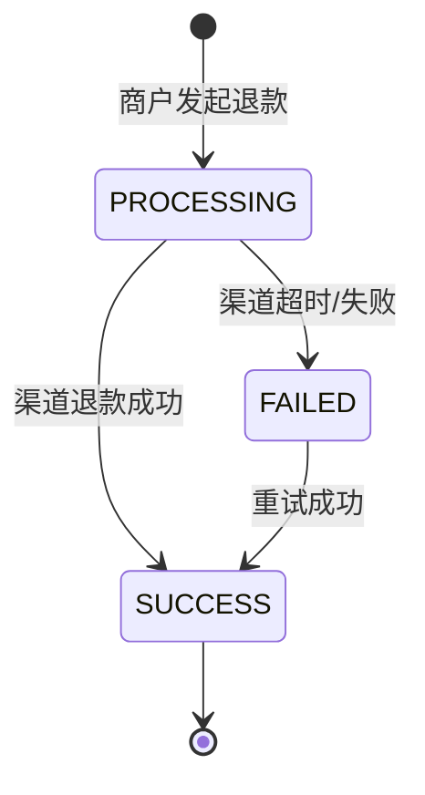
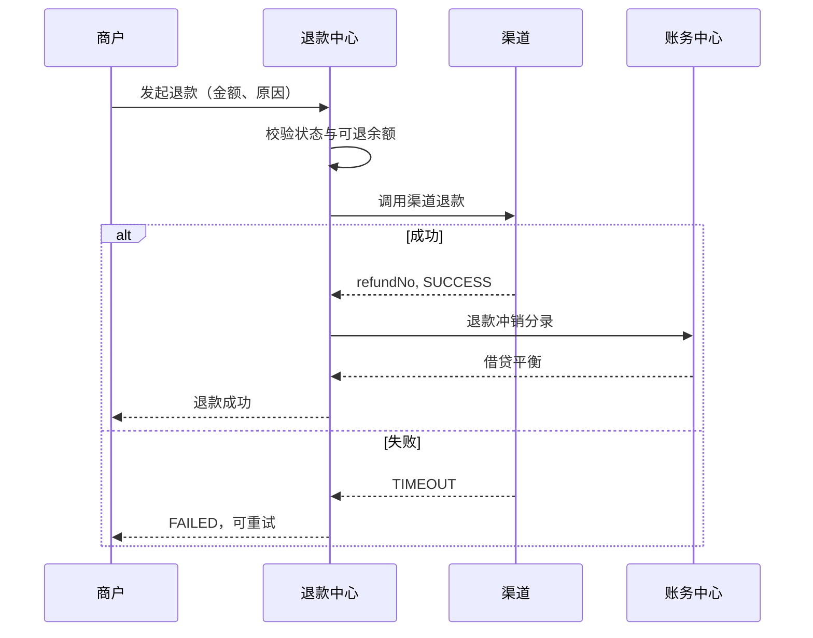
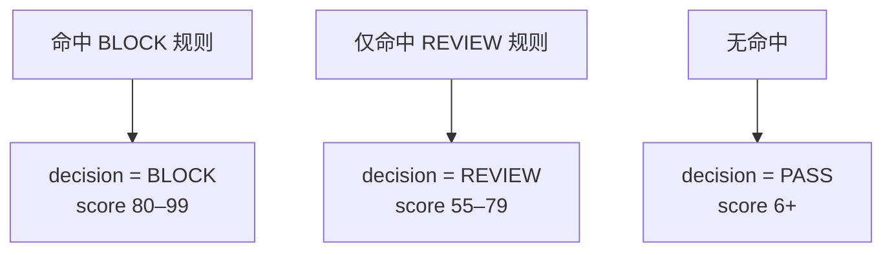

# 退款与风控

退款处理「支付成功之后的反向资金流」，风控处理「支付发生之前的风险决策」。两者共同构成支付系统的安全边界。

## 1. 退款状态机



退款单独立于支付单：

- 支付单状态不会因为退款而回退；
- 退款金额累计记录在 `payment.refundedAmount`；
- `refundStatus` 表示整体进度：`NONE` / `PARTIAL` / `FULL`。

## 2. 退款规则

| 规则 | 说明 |
| --- | --- |
| 可退款对象 | 只有 `status = SUCCESS` 的支付单 |
| 退款上限 | 累计退款 ≤ 支付金额 |
| 部分退款 | 支持多次退款，直到累计达到全额 |
| 手续费 | 普通退款不退还手续费 |
| 补偿退款 | 迟到回调等场景全额退款并回退手续费 |
| 幂等 | 同一退款单只生成一次冲销分录 |

## 3. 退款流程



### 普通退款分录

```text
借：商户待结算款      退款金额
  贷：渠道应收款      退款金额
```

### 补偿退款分录

```text
借：商户待结算款      退款金额
  贷：渠道应收款      退款金额

借：手续费收入        原手续费
  贷：商户待结算款    原手续费
```

补偿退款用于「订单已关闭但渠道已扣款」等异常场景，必须同时回退手续费，才能让支付 + 退款两笔分录合计为零。

## 4. 部分退款示例

支付 999.00，手续费 5.99，商户净额 993.01。

退款 30.00：

```text
借：商户待结算款     30.00
  贷：渠道应收款     30.00
```

结果：

- `refundedAmount = 3000`；
- `refundStatus = PARTIAL`；
- 商户最终可结算净额 = 993.01 − 30.00 = 963.01；
- 手续费不退还。

再次退款 969.00 后，累计达到全额，`refundStatus = FULL`。

## 5. 退款重试

失败退款可以重试：

`POST /api/refunds/:id/retry`

- 只允许 `FAILED` 状态重试；
- 重试成功后补写退款事件与冲销分录；
- 分录幂等，不会重复记账。

创建退款时可通过 `simulateFail: true` 模拟渠道超时，便于演示失败与重试。

## 6. 风控规则

| 规则 | 条件 | 决策 |
| --- | --- | --- |
| `R001` 单笔金额阈值 | ≥ ¥5,000 复核；≥ ¥50,000 拦截 | REVIEW / BLOCK |
| `R002` 夜间大额 | 00:00–06:00 且 ≥ ¥1,000 | REVIEW |
| `R003` 黑名单用户 | 买家在 `U-BLACKLIST`、`U-6666` 名单中 | BLOCK |
| `R004` 高频交易 | 同一买家 60 秒内 ≥ 5 笔 | BLOCK |
| `R005` 新设备异地 | 新设备且 ≥ ¥2,000（默认关闭） | REVIEW |

规则可启停、可修改参数：

`PUT /api/risk/rules/:id`

```json
{
  "enabled": true,
  "params": {
    "reviewAmount": 3000,
    "blockAmount": 30000,
    "users": "U-BLACKLIST,U-6666,U-VIP"
  }
}
```

金额参数会自动转换为「分」；`users` 支持逗号分隔字符串。

## 7. 决策与评分



评分规则：

```text
BLOCK  = min(99, 80 + 命中数 × 4)
REVIEW = min(79, 55 + 命中数 × 5)
PASS   = 6 + 命中数 × 2
```

每个命中项包含 `ruleId`、`ruleName`、`level`、`detail`，在演练台与阶段详情中展示。

## 8. 风控在支付链路中的位置

风控发生在调用渠道之前：

```text
网关校验 → 实时风控 → 渠道路由 → 预下单
```

| 决策 | 处理 |
| --- | --- |
| `PASS` | 直接进入路由 |
| `REVIEW` | 支付暂停，等待人工复核；通过后继续，拒绝则失败 |
| `BLOCK` | 立即终止，订单关闭 |

对应场景：

- `risk_block`：黑名单买家，直接拦截；
- `large_review`：大额交易进入人工复核。

## 9. 风险试算

`POST /api/risk/check`

```json
{
  "amount": 6800,
  "buyer": "U10002",
  "channel": "wechat",
  "hour": 2,
  "isNewDevice": true
}
```

返回：

```json
{
  "decision": "REVIEW",
  "score": 60,
  "hits": [
    { "ruleId": "R001", "ruleName": "单笔金额阈值", "level": "REVIEW", "detail": "..." },
    { "ruleId": "R002", "ruleName": "夜间大额交易", "level": "REVIEW", "detail": "..." }
  ]
}
```

试算不会创建支付单，只记录最近 20 条试算历史。

## 10. 相关 API

| 方法 | 路径 | 说明 |
| --- | --- | --- |
| `GET` | `/api/refunds` | 退款列表 |
| `POST` | `/api/refunds` | 发起退款 |
| `POST` | `/api/refunds/:id/retry` | 重试失败退款 |
| `GET` | `/api/risk` | 规则与试算历史 |
| `PUT` | `/api/risk/rules/:id` | 修改规则 |
| `POST` | `/api/risk/check` | 风控试算 |

完整接口见 [HTTP API 参考](09-api.md)。
